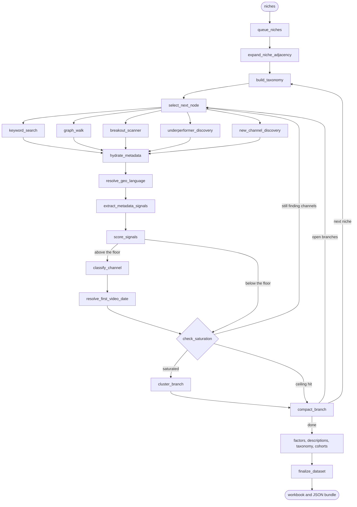

# graph-research

[](https://github.com/CipherDriftX/graph-research/actions/workflows/ci.yml)

graph-research maps a YouTube niche. You name a topic, such as personal finance or true crime, and it finds the channels in that space, enriches every one of them, and writes an Excel workbook you can filter, sort and pivot.

Keyword search on YouTube keeps returning the same large channels. Channels also point at each other through the featured-channels list on their page, the videos YouTube recommends next, and the people who comment. Following those links reaches channels that search never returns. The pipeline runs both methods side by side and records which one found each channel, so the workbook shows exactly what the graph walk added.

It is a LangGraph state machine over Postgres, with a React console for starting runs and watching them live.

## How a run works



A run plans first. `queue_niches` orders the niches you passed, and `expand_niche_adjacency` adds neighbouring niches from a curated ontology, scored against the channel graph that earlier runs left in the store. `build_taxonomy` asks the model for a tree of sub-niches, each with seed keywords and channels.

Then it loops over the open branches of that tree. Five discovery tracks run in parallel for each one. Keyword search and the graph walk are the main pair, and three smaller passes correct their bias: channels whose videos far outrun their subscriber count, small channels the walk skipped on purpose, and channels created since 2024. Every new channel is fetched from the YouTube Data API and scored on geography, language, upload cadence, engagement, evergreen content and outlier videos. Only channels above the subscriber floor go on to the model for format and niche classification, so LLM spend lands on the channels the workbook will show.

A branch is done when both main tracks have found almost nothing new for several rounds in a row. Louvain community detection then looks for sub-communities in the branch's channel graph, and the model only names and confirms the clusters it found. A confirmed cluster becomes a new branch, so the tree grows as deep as the data supports.

At the end, the remaining steps fill in success and failure factors, video descriptions, taxonomy fields, niche families and cohorts. `finalize_dataset` writes rollups and percentile ranks to the store. Before the export, a completeness check re-runs any step whose columns came out short, and after it the workbook is opened and read back cell by cell.

Discovery comes from Bright Data's YouTube collectors and metadata from the YouTube Data API. Model calls go to DeepSeek V4 through OpenRouter, with Kimi as the fallback when a call is rate-limited or times out.

## What you get

Each run writes to `exports/<run_id>/`:

| File | Contents |
| --- | --- |
| `<run_id>.xlsx` | Overview, Channels, Videos, Shorts, Niche Families, Niches, Success Factors and Failure Factors sheets |
| `channels.csv`, `outlier_videos.csv` | the two main tables as flat files |
| `discovery_graph.html` | a standalone interactive view of the discovery graph |
| `discovery_graph.json` | the same graph as nodes and edges |
| `research_bundle.json` | the manifest plus every channel, video and edge |
| `manifest.json` | counts, which track found how many channels, spend by source, stop reasons |

Everything also stays in Postgres, so later runs build on earlier ones. A channel found by two runs is stored once and tagged with both.

## Setup

You need Python 3.11+ (CI runs 3.12), Postgres (CI runs 16) and, for the console, Node 22.

```bash
git clone git@github.com:CipherDriftX/graph-research.git
cd graph-research
python -m venv .venv && source .venv/bin/activate
pip install -e '.[dev,console,mcp]'
cp .env.example .env
```

Fill in `.env`. A live run needs three keys:

| Variable | From |
| --- | --- |
| `OPENROUTER_API_KEY` | [openrouter.ai](https://openrouter.ai/keys) |
| `YOUTUBE_API_KEY` | Google Cloud, with YouTube Data API v3 enabled |
| `BRIGHTDATA_API_KEY` | [Bright Data](https://brightdata.com), with access to the YouTube datasets |

If you have no Postgres running, Docker gives you one:

```bash
docker run -d --name graph-research-db -p 5432:5432 \
  -e POSTGRES_USER=niche_harness -e POSTGRES_PASSWORD=change_me \
  -e POSTGRES_DB=niche_harness postgres:16
```

The schema applies itself on the first run.

## Running it

```bash
graph-research "personal finance"                       # one niche
graph-research "personal finance" "investing" "budgeting" # first is the target, the rest follow
graph-research --resume <thread_id>                     # continue from the last checkpoint
graph-research --augment "personal finance"             # new run that starts from the stored channels
graph-research --snapshot                               # refresh stats for every stored channel and video
```

The command checks for missing keys before it starts and stops with their names. Every step is checkpointed, so `--resume` picks up a crashed or stopped run where it left off.

`--snapshot` makes no Bright Data or LLM calls. It costs one YouTube quota unit per 50 channels plus one per 50 videos, and each refresh adds a snapshot row that growth measures are computed from.

To export an earlier run again:

```bash
python -m src.export <run_id> --excel
```

### Run size and cost ceilings

`HARNESS_PROFILE` in `.env` sets every ceiling at once:

| Profile | Bright Data records | Spend ceiling | Tree depth | Comment mining |
| --- | --- | --- | --- | --- |
| `smoke` | 150 | $1 | 1 | off |
| `bounded` | 1,500 | $5 | 2 | on |
| `full` | no cap | $10 | no cap | on |

The spend ceiling covers Bright Data records and model calls together. Saturation is the intended way for a run to end. The ceilings are circuit breakers against a bug in the frontier logic, and each stop reason is logged separately, so a run that hit a ceiling never looks like one that saturated. In `bounded` and `full`, each top-level branch also gets its own share of the budget, so one runaway branch cannot starve the others.

The console has its own presets, Sample, Standard and Deep, aimed at about 50, 250 and 500 channels. Each card shows the estimated cost and time before you start.

### Replay mode

```bash
BRIGHTDATA_MODE=replay YOUTUBE_MODE=replay graph-research "personal finance"
```

Replay serves the recorded responses in `fixtures/` in place of the live APIs, so discovery and hydration cost nothing. The budget counters still run, so the ceilings behave as they would live. The LLM steps still need an OpenRouter key. `scripts/record_youtube_fixtures.py` rebuilds the YouTube fixtures from public channel feeds.

## Console

```bash
cd web && npm ci && npm run build && cd ..
uvicorn src.api.server:app --port 8000
```

Open http://localhost:8000. FastAPI serves the built console and its API from one process. For frontend work, run `npm run dev` in `web/` next to uvicorn and open http://localhost:5173.

| Page | What it does |
| --- | --- |
| New run | pick niches and a depth, see the estimated cost and time, start |
| Live runs | follow each node as it runs over server-sent events, stop a run |
| Graph | the discovery graph, coloured by which track found each channel |
| Workbooks | download finished workbooks, see the branch tree and spend behind each |
| Spend | model cost per run and per node, from the amount OpenRouter bills |
| Balances | remaining OpenRouter credit, and the Bright Data balance if you add a Finance-scoped token |

The console launches each run as `python -m src.cli`, the entry point behind the `graph-research` command, so a run behaves the same whichever way you start it.

## MCP server

```bash
graph-research-mcp
```

It speaks MCP over stdio and exposes three tools: `research_niches` runs the pipeline and returns the export path, `search_channels` searches the stored channels, and `top_outlier_videos` lists the videos that beat their own channel's usual views by the widest margin. To add it to an MCP client, point the client at the `graph-research-mcp` command inside your virtualenv.

## Tests

```bash
python -m pytest
ruff check src scripts tests
```

There are 1,117 tests. Tests that need a database skip when Postgres is unreachable, so the unit suite runs anywhere. CI starts Postgres and runs everything, then lints and builds the console.

`tests/test_replay.py` runs the real graph end to end on recorded Bright Data with the model calls mocked. It is where routing bugs, reducer collisions and runs that never terminate show up without spending anything.

## Layout

```
src/
  graph.py         graph wiring, routing and the run entry point
  state.py         typed state, reducers and checkpoint migrations
  config.py        every setting, the profiles and the cost ceilings
  cli.py           the graph-research command
  mcp_server.py    the MCP tools
  export.py        JSON bundle and Excel workbook
  nodes/           one module per graph node
  tools/           API clients, discovery tracks, scoring, clustering, export checks
  llm/             OpenRouter client, tier routing and JSON repair
  db/              schema.sql, connection pools, checkpointer and seed data
  api/             FastAPI backend for the console
  observability/   structured logs and the per-node JSONL stream
web/               React 19, Vite and Tailwind console
fixtures/          recorded API responses for replay mode
scripts/           fixture recorder
tests/
```

## Design choices

### One Postgres database

The channel store, the discovery edges and the LangGraph checkpoints all live in Postgres. Runs share the store, so `--augment` and the adjacency scoring start from what earlier runs found.

### Code decides, the model labels

Branch selection, saturation and clustering are plain Python with fixed seeds, so they are testable and give the same answer twice. The model gets the jobs that need language: the first taxonomy, names for clusters Louvain already found, and channel classification from titles and descriptions.

### Spend follows the workbook

The subscriber floor is checked before any model call on a channel, and branch budgets are weighted by priority. The expensive steps run on the rows that will appear in the export.

### Tables, no generated report

An earlier version ended each run with a written report. It was dropped because the people using the data run their own analysis, and a filterable workbook serves that better than prose.

### Every channel records its track

The Channels sheet and the Graph page show, for each channel, whether keyword search, the graph walk or both found it, and the manifest counts each group.
